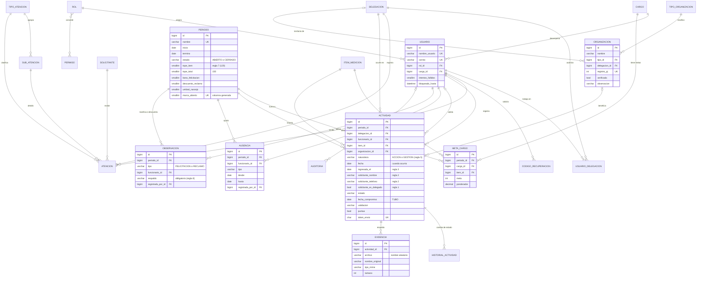

# Modelo de datos · SGR La Serena (EV2)

Base de datos relacional en **MySQL 8.0** (producción, AWS EC2) y SQLite (desarrollo y pruebas). El esquema lo generan las migraciones de Django; el volcado equivalente está en [`sgr_ev2_esquema_mysql.sql`](sgr_ev2_esquema_mysql.sql) (31 tablas, `utf8mb4_0900_ai_ci`, InnoDB).

| Archivo | Contenido |
|---|---|
| `sgr_ev2_esquema_mysql.sql` | `mysqldump --no-data` de la base migrada |
| `explain_mysql8_antes_de_optimizar.txt` | Planes de ejecución con 60.000 actividades y los índices iniciales |
| `explain_mysql8.txt` | Los mismos planes con los índices definitivos |
| `../../scripts/medir_consultas.py` | Script que carga el volumen y ejecuta `EXPLAIN ANALYZE` |

---

## 1. Diagrama entidad-relación

Se omiten los campos de control repetidos (`activo`, `creado`, `actualizado`) y las tablas internas de Django (sesiones, migraciones, tipos de contenido).



### Entidades por módulo

| Módulo | Tablas | Para qué |
|---|---|---|
| Catálogos | `catalogos_delegacion`, `catalogos_itemmedicion`, `catalogos_cargo`, `catalogos_tipoatencion`, `catalogos_subatencion` | Datos maestros que mantiene la coordinación |
| Cuentas | `cuentas_usuario`, `cuentas_rol`, `cuentas_permiso`, `cuentas_rol_permisos`, `cuentas_usuario_delegaciones`, `cuentas_codigorecuperacion`, `cuentas_correosaliente` | Acceso, perfiles, alcance por delegación y recuperación de clave |
| Atenciones | `atenciones_solicitante`, `atenciones_atencion` | Atención a vecinos por RUT (EV1) |
| Matriz SGR | `gestion_periodo`, `gestion_metacargo`, `gestion_actividad`, `gestion_historialactividad`, `gestion_evidencia`, `gestion_ausencia`, `gestion_observacion` | Las hojas por cargo, SEMÁFORO, TUBO, FELICITACIONES y RECLAMOS del Excel trimestral |
| Organizaciones | `gestion_tipoorganizacion`, `gestion_organizacion` | Base JJVV y organizaciones funcionales por territorio |
| Control | `core_auditoria` | Bitácora de operaciones y accesos denegados |

### Del Excel a la base

| Hoja del Excel trimestral | Dónde queda |
|---|---|
| Una hoja por cargo (metas y ponderaciones) | `gestion_metacargo` (período × cargo × ítem) |
| Filas de actividades y TUBO | `gestion_actividad` (con `fecha_compromiso` para el TUBO) |
| SEMÁFORO (días de ausencia) | `gestion_ausencia`; los días efectivos se calculan |
| FELICITACIONES y RECLAMOS | `gestion_observacion` con respaldo obligatorio |
| RESUMEN | No se guarda: se calcula en `gestion/calculos.py` desde las tablas anteriores |
| Parámetros (topes, bono, descuento, umbrales) | Columnas de `gestion_periodo`, editables por período |

---

## 2. Normalización

### Primera forma normal (1FN)

- Cada columna guarda un solo valor. En el Excel una celda podía tener «3 CLUBES» o varios teléfonos; en la base, `socios` es entero y el texto dudoso queda en `observacion` al importar.
- No hay grupos repetidos: las metas de un cargo no son 29 columnas de una hoja, son 29 filas de `gestion_metacargo`.
- Cada tabla tiene clave primaria (`id`, entero de 64 bits).

### Segunda forma normal (2FN)

- Las tablas con clave compuesta natural (`gestion_metacargo`: período + cargo + ítem; `cuentas_permiso`: módulo + acción) tienen restricción `UNIQUE` sobre esa combinación, y sus columnas no clave (`meta`, `ponderador`) dependen de la combinación completa, no de una parte.
- El nombre del ítem o del cargo no se repite en las metas: se referencia por clave foránea.

### Tercera forma normal (3FN)

- Ningún dato no clave depende de otro dato no clave. El nombre de la delegación, del ítem, del cargo o del tipo de organización está una sola vez en su catálogo.
- El resultado de la matriz (cumplimiento, total, semáforo, resultado de equipo) **no se guarda**: se calcula con consultas agregadas. Así no puede quedar desactualizado cuando se valida, rechaza o cierra una actividad.

### Desnormalizaciones deliberadas (y por qué)

| Columna | Dependencia | Justificación | Cómo se mantiene consistente |
|---|---|---|---|
| `actividad.periodo_id` | Se podría deducir de `fecha` | Un período cerrado congela sus actividades; además evita un rango de fechas en cada consulta del tablero | La vista asigna el período abierto y rechaza fechas fuera de él |
| `actividad.delegacion_id` | Un usuario puede tener varias delegaciones | Es la delegación **en la que se hizo** la actividad (la activa al registrar), no un dato del usuario | Lo asigna el servidor; no viene del formulario (prueba RG-16) |
| `actividad.puntua`, `motivo_sin_puntaje` | Se derivan de las reglas 1, 2 y 5 | Permite sumar con `COUNT` sobre un índice en vez de evaluar reglas fila por fila | Se recalculan en cada guardado (`aplicar_reglas_de_puntaje`) |
| `actividad.solicitante_nombre`, `solicitante_telefono` | Parecido a `atenciones_solicitante` | Es el contacto **en el momento de la solicitud** (regla 2) y muchas actividades no tienen RUT; no es el maestro de vecinos | Teléfono normalizado a +56 |
| `auditoria.usuario_texto`, `delegacion` | Nombre del usuario | La bitácora debe seguir legible aunque el usuario cambie de nombre o se desactive | Solo se escribe una vez |
| `periodo.marca_abierto` | Se deriva de `estado` | MySQL no admite índices únicos parciales; la columna generada (1 si está abierto, NULL si no) con índice único impide un segundo período abierto en la propia base | La calcula MySQL (`GENERATED ALWAYS … STORED`) |

---

## 3. Integridad

| Regla | Dónde se garantiza |
|---|---|
| Claves foráneas | `FOREIGN KEY` en InnoDB; borrado `PROTECT` en catálogos: no se elimina un ítem, cargo o delegación en uso (pruebas PI-xx) |
| Unicidad sin distinguir mayúsculas | Índices sobre `LOWER(nombre)` en catálogos (`delegacion_nombre_unico_ci`, `item_nombre_unico_ci`, …) |
| Un solo período abierto | Índice único sobre `marca_abierto` (prueba PV-16) |
| Fechas coherentes | `CHECK (termino > inicio)` en períodos y `CHECK (hasta >= desde)` en ausencias |
| Una meta por cargo e ítem en cada período | `UNIQUE (periodo_id, cargo_id, item_id)` |
| Sin doble envío | `UNIQUE (token_envio)` en actividades y atenciones (RG-15, UI-07) |
| Una organización por registro de personalidad jurídica | `UNIQUE (registro_pj)` |
| Cupo diario (regla 3) bajo concurrencia | `SELECT … FOR UPDATE` sobre el usuario dentro de la transacción del registro |

---

## 4. Índices y optimización

Se midió con **60.000 actividades** (≈ un año de 6 delegaciones) en MySQL 8.0 con `EXPLAIN ANALYZE` (`scripts/medir_consultas.py`).

| Consulta | Índice | Antes | Después | Cambio |
|---|---|---|---|---|
| Ingresos del día (regla 3) | `act_ingresos_diarios (funcionario, ingresada_el)` | 0,7 ms | 0,6 ms | Búsqueda directa de 64 filas |
| Avance por ítem del período | `act_avance_item (funcionario, periodo, estado, puntua, validacion, item)` | 13,7 ms | **2,1 ms** | Pasó de leer 4.004 filas completas a un **índice cubriente** (no toca la tabla) |
| Listado de la delegación | `act_delegacion_fecha (delegacion, fecha DESC, id DESC)` | 0,7 ms | 0,5 ms | Lee solo las 25 filas de la página |
| Bandeja de validación | `act_bandeja_validacion (delegacion, validacion, fecha DESC, id DESC)` | 13,0 ms | **0,5 ms** | Antes ordenaba 12.236 filas en memoria; ahora lee 25 en orden desde el índice |
| Matriz completa de una delegación | (todas las anteriores) | 158 ms | 109–136 ms | 6 consultas agregadas, sin N+1 (prueba PF-01) |

Otras decisiones:

- **Sin N+1**: el tablero hace las mismas consultas con 10 o con 500 actividades (PF-01). El cálculo usa `values().annotate(Count)` por funcionario e ítem en vez de recorrer filas.
- **Paginación** de 25 filas en todos los listados.
- **Búsqueda de organizaciones** por nombre sin distinguir mayúsculas con índice funcional `org_nombre_ci (LOWER(nombre))`.
- **Archivos fuera de la base**: las evidencias se guardan en disco con nombre aleatorio; la base guarda solo la ruta, el tipo y el tamaño.

Para repetir la medición:

```bash
SGR_DB_MOTOR=mysql python manage.py migrate
SGR_DB_MOTOR=mysql python manage.py sgr_inicializar --demo
SGR_DB_MOTOR=mysql python scripts/medir_consultas.py --volumen 60000 > docs/bd/explain_mysql8.txt
```

Use una base de pruebas: el script agrega actividades sintéticas.
