# Manual de usuario · SGR La Serena

Sistema de Gestión de Resultados de las delegaciones municipales. Reemplaza el Excel trimestral de la matriz SGR: cada funcionario registra lo que hace, el delegado lo valida y el sistema calcula el cumplimiento, el semáforo y el resultado del equipo.

> Las capturas usan datos ficticios de demostración (fecha del sistema: miércoles 04-11-2026).

**Contenido**

1. [Ingreso y recuperación de clave](#1-ingreso-y-recuperación-de-clave)
2. [Qué ve cada perfil](#2-qué-ve-cada-perfil)
3. [Funcionario: registrar el trabajo diario](#3-funcionario-registrar-el-trabajo-diario)
4. [Delegado: validar, ausencias y felicitaciones](#4-delegado-validar-ausencias-y-felicitaciones)
5. [Coordinación: períodos, metas y organizaciones](#5-coordinación-períodos-metas-y-organizaciones)
6. [Cómo se calcula el puntaje](#6-cómo-se-calcula-el-puntaje)
7. [Mensajes frecuentes y qué hacer](#7-mensajes-frecuentes-y-qué-hacer)

---

## 1. Ingreso y recuperación de clave

1. Abra el sistema y escriba su **usuario o correo** y su **contraseña**.
2. Si se equivoca 5 veces, la cuenta se bloquea 10 minutos. Si desde un mismo equipo se hacen muchos intentos con distintas cuentas, el sistema pausa los intentos de esa conexión durante 15 minutos.
3. ¿Olvidó la clave? Pulse **«¿Olvidó su contraseña?»**, escriba su correo y copie el **código de 6 dígitos** que llega (vence en 10 minutos). Luego defina una clave nueva de al menos 8 caracteres con mayúscula, minúscula, número y símbolo.

**Cuenta nueva.** Cuando el administrador o su delegado crea su cuenta, le llega un correo de bienvenida con su usuario y un enlace para **crear su propia contraseña**. El enlace sirve una sola vez y vence en 72 horas; si vence, use «¿Olvidó su contraseña?».

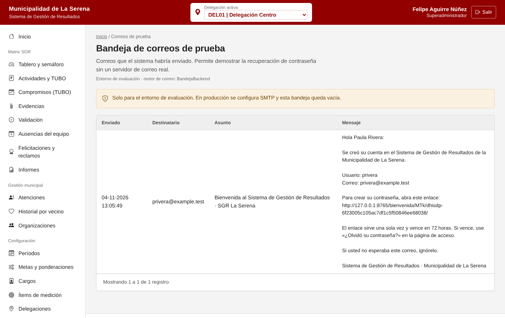

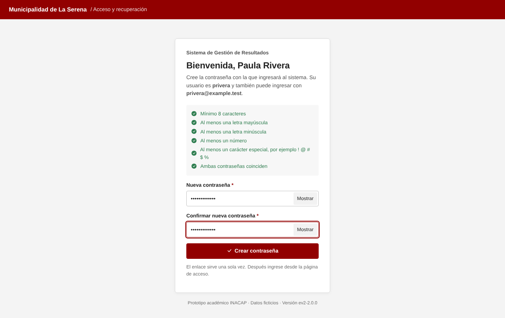

Si trabaja en más de una delegación, elija la **delegación activa** en el selector de la cabecera. Todo lo que vea y registre corresponde a esa delegación.

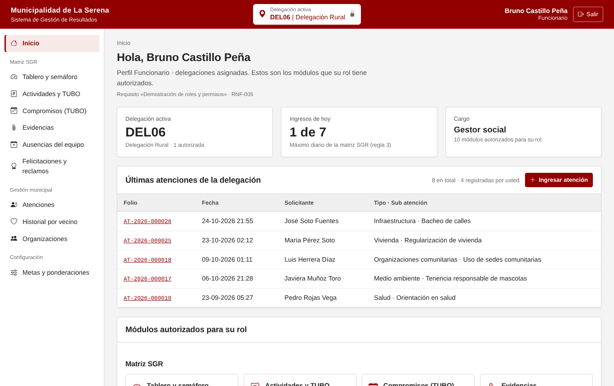

---

## 2. Qué ve cada perfil

| Perfil | Puede | No puede |
|---|---|---|
| **Funcionario** | Registrar sus actividades, adjuntar evidencias, ver su ficha y sus compromisos, ver organizaciones de su territorio | Ver actividades de otros, validar, registrar ausencias o felicitaciones |
| **Delegado municipal** | Todo lo del funcionario, más: ver al equipo, validar o rechazar, registrar ausencias, felicitaciones y reclamos, exportar informes | Cambiar metas o períodos; validar sus propias actividades |
| **Coordinador** | Configurar períodos, metas por cargo, cargos, ítems y catálogos; ver todas las delegaciones | Registrar actividades a nombre de otros |
| **Consultor** | Ver tablero, informes y catálogos | Registrar o modificar |
| **Superadministrador** | Todo, incluidos usuarios, roles, permisos y auditoría | — |

El menú solo muestra lo que su perfil permite. Si intenta abrir una dirección que no le corresponde, verá «Acceso denegado» y el intento queda registrado.

---

## 3. Funcionario: registrar el trabajo diario

### 3.1 Ver mi avance

**Matriz SGR → Tablero y semáforo** muestra su cumplimiento, cuántos ingresos lleva hoy (máximo 7) y el avance de cada ítem de su cargo. La línea negra marca lo **esperado al día** según cuánto va del trimestre.

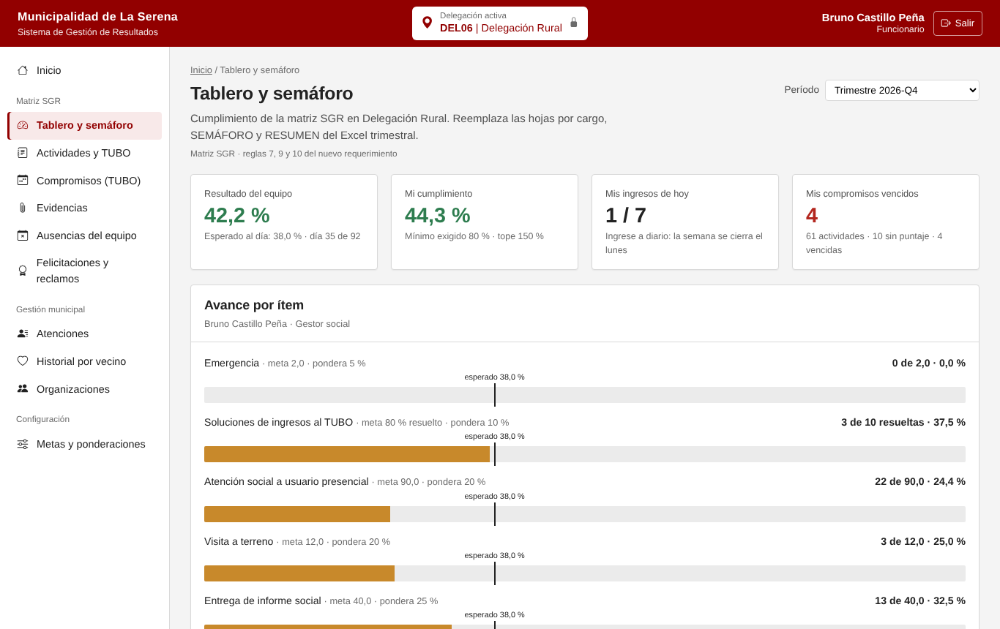

Colores del semáforo:

- **Verde**: va igual o sobre lo esperado al día.
- **Naranjo**: está bajo lo esperado, pero sobre el 60 % de lo esperado.
- **Rojo**: está bajo el 60 % de lo esperado.

### 3.2 Registrar una actividad

**Actividades y TUBO → Registrar actividad**

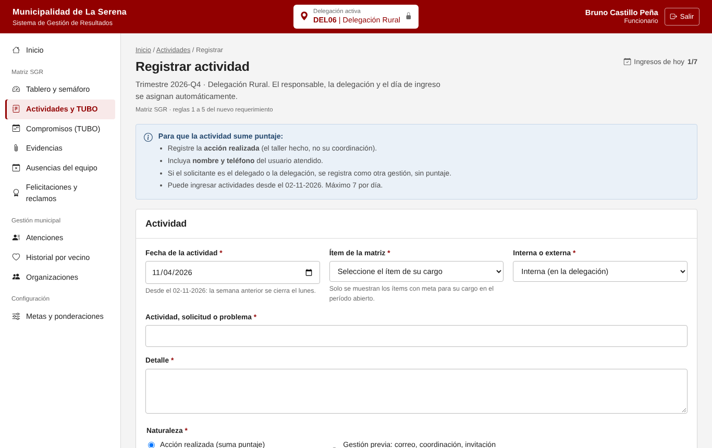

1. **Fecha**: el día en que hizo la actividad. Puede registrar desde el lunes de la semana anterior hasta hoy; **la semana se cierra el lunes siguiente** (desde el martes ya no se puede ingresar la semana anterior).
2. **Ítem de la matriz**: solo aparecen los ítems con meta para su cargo.
3. **Actividad y detalle**: qué hizo, con suficiente detalle para que el delegado pueda validarlo.
4. **Naturaleza**:
   - *Acción realizada*: suma puntaje (el taller, la visita, la entrega).
   - *Gestión previa*: correos, coordinaciones o invitaciones. Se registra, pero **no suma**.
5. **Usuario atendido**: **nombre y teléfono son obligatorios para que sume**. Sin ellos la actividad se guarda, pero no cuenta.
6. **La solicita el delegado**: márquelo si el pedido vino del delegado o de la delegación. Se guarda como otra gestión y **no suma**.
7. **Estado**: si queda *Pendiente* o *En proceso*, indique la **fecha de compromiso**. Así entra al TUBO.
8. Pulse **Guardar actividad**. Aunque haga doble clic, se guarda una sola vez.

Puede registrar **hasta 7 actividades por día**. Al llegar al límite, el botón se desactiva. Registre a diario: acumular varios días en uno genera alertas para el delegado.

### 3.3 Cerrar un compromiso (TUBO)

**Compromisos (TUBO)** lista sus solicitudes abiertas por vencer y vencidas. Abra la actividad, elija **Realizado**, escriba una observación y guarde. La actividad suma desde ese momento y queda en su historial.

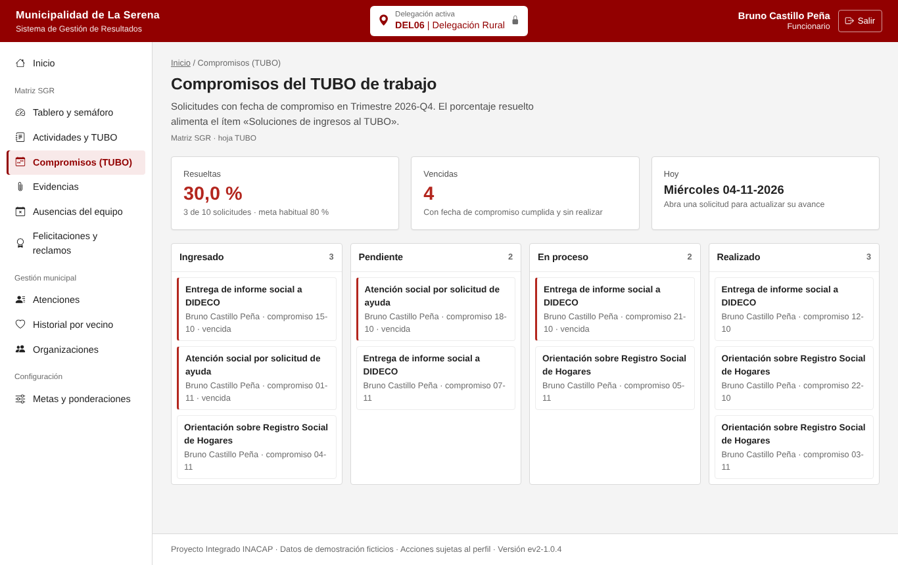

### 3.4 Adjuntar evidencias

En el detalle de la actividad, sección **Evidencias**, adjunte fotos (JPG, PNG) o documentos PDF de hasta 2 MB. El sistema revisa que el archivo sea realmente del tipo indicado.

### 3.5 Mis actividades

**Actividades y TUBO** lista todo lo que registró, con búsqueda, filtros por estado, ítem y validación, y exportación a Excel. La columna «Puntaje» indica si suma y, si no, por qué.

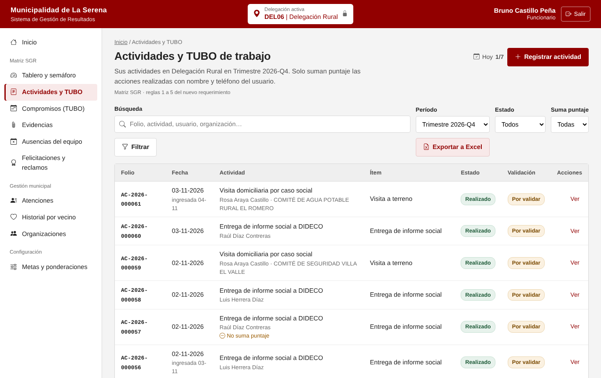

---

## 4. Delegado: validar, ausencias y felicitaciones

### 4.1 Tablero del equipo

El delegado ve el **resultado del equipo** (promedio de quienes tienen metas), el semáforo de cada integrante, las **alertas de registro** y puede abrir la ficha de cualquier integrante con «Ver ficha de».

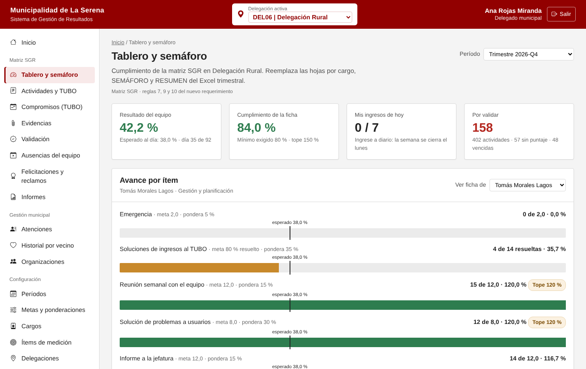

Las **alertas** (regla 6) no bloquean: avisan cuando alguien llega al tope diario, repite el mismo texto, ingresa muchas actividades días después o tiene muchas que no suman. Úselas para conversar con el equipo.

### 4.2 Validar

**Validación** muestra las actividades pendientes de su delegación. Puede **validar** o **rechazar** indicando el motivo. Una actividad rechazada deja de sumar. No puede validar sus propias actividades.

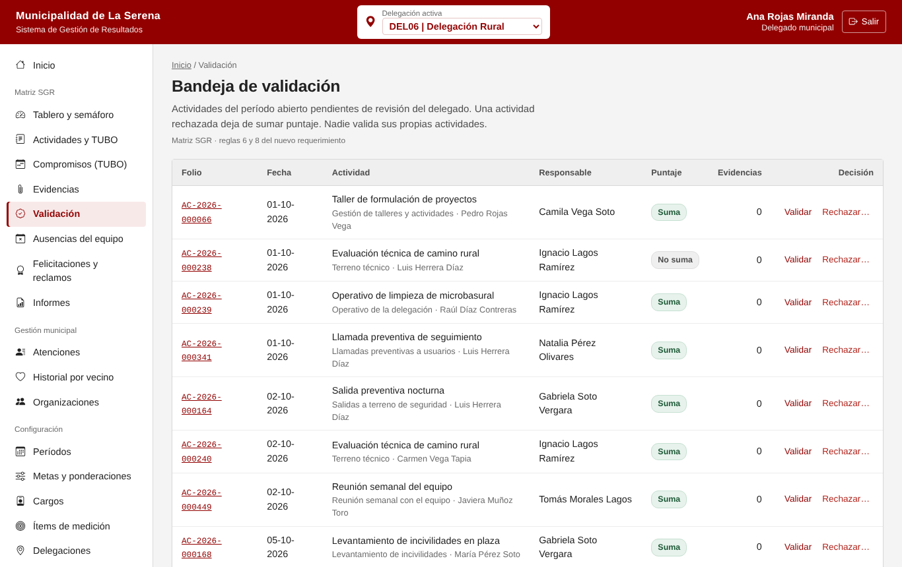

### 4.3 Ausencias

**Ausencias del equipo**: registre licencias, vacaciones, emergencias, días administrativos y compensatorios. La meta del funcionario se ajusta a sus días efectivos. Ejemplo: 23 días de licencia en un trimestre de 92 días reducen una meta de 90 a 67,5. El sistema rechaza ausencias superpuestas.

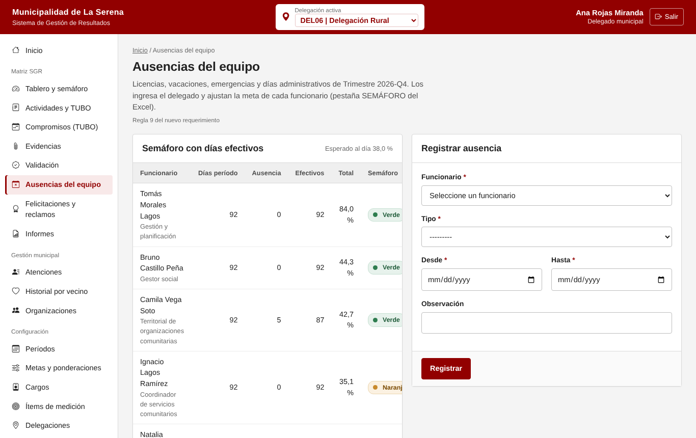

### 4.4 Felicitaciones y reclamos

Registre la felicitación o el reclamo **con su respaldo formal** (correo, carta, libro de reclamos) en PDF o imagen. Sin respaldo no se guarda. Solo el delegado puede registrarlas.

- Cada felicitación suma **+10 %** al total del funcionario (máximo 3 en el período).
- Cada reclamo descuenta **20 %**.

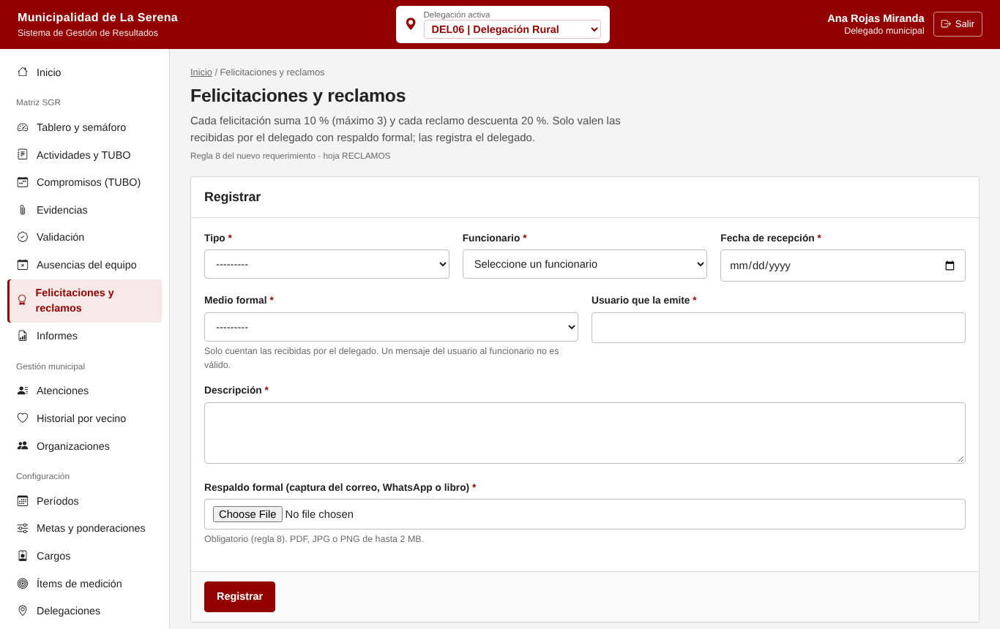

### 4.5 Informes

**Informes** muestra la matriz completa del período por funcionario e ítem y la exporta a Excel (funcionario, cargo, ítem, meta, meta ajustada, avance, cumplimiento, ajustes, total y semáforo).

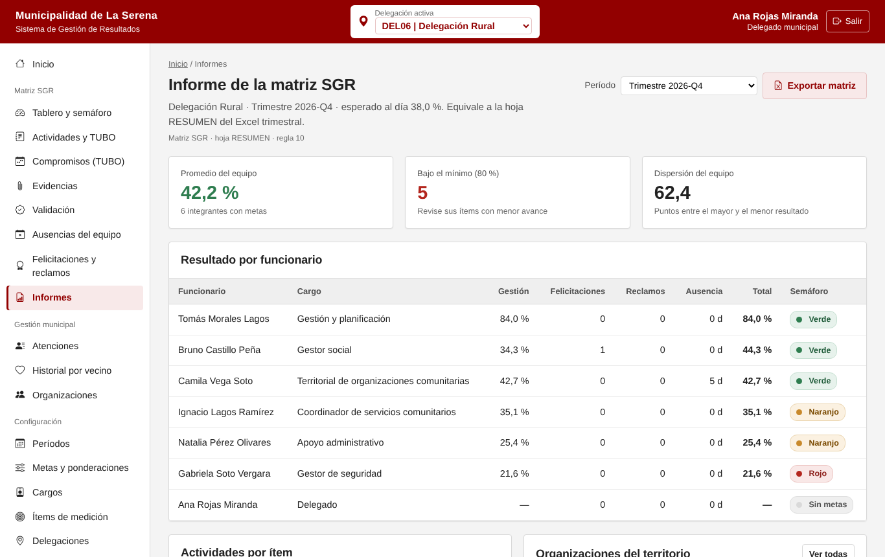

### 4.6 Organizaciones

**Organizaciones** lista las juntas de vecinos y organizaciones funcionales de su territorio. Las marcadas «Por verificar» vienen de la base JJVV y tienen alguna observación (territorio inferido, socios no numéricos, fechas dudosas).

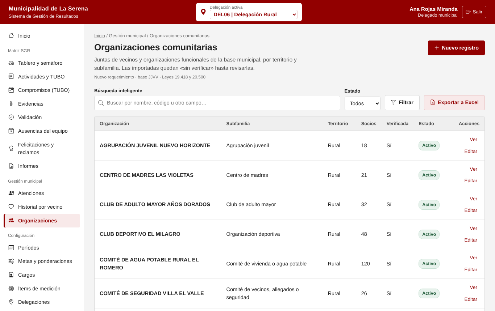

---

## 5. Coordinación: períodos, metas y organizaciones

### 5.1 Períodos

**Configuración → Períodos**: cree el trimestre con sus parámetros (tope por ítem 120 %, tope total 150 %, bono por felicitación, descuento por reclamo, umbral naranjo y cumplimiento mínimo). Solo puede haber **un período abierto**. Al cerrar un período sus actividades quedan congeladas. Puede **copiar las metas** del período anterior al nuevo.

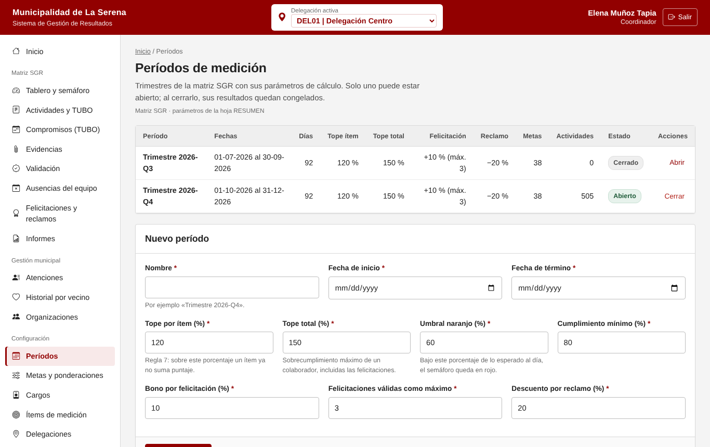

### 5.2 Metas y ponderaciones

**Metas y ponderaciones**: para cada cargo, la meta y el ponderador de cada ítem. Los ponderadores de un cargo deben sumar 100 %. Los ítems de tipo TUBO se miden como porcentaje de solicitudes resueltas.

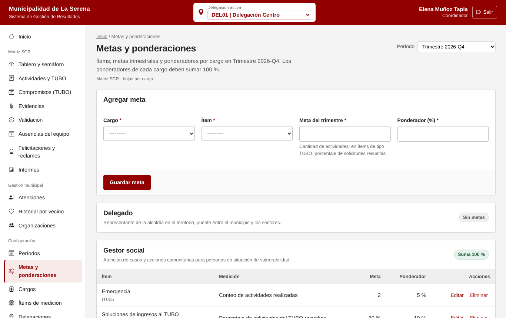

### 5.3 Importar la base de organizaciones

La importación se hace en el servidor (no desde el navegador) porque la base contiene datos personales:

```bash
python manage.py sgr_importar_organizaciones base_jjvv.xlsx --simular   # revisa sin guardar
python manage.py sgr_importar_organizaciones base_jjvv.xlsx             # importa
```

---

## 6. Cómo se calcula el puntaje

| Paso | Fórmula |
|---|---|
| Meta ajustada | meta × días efectivos ÷ días del período (regla 9) |
| Cumplimiento del ítem | avance ÷ meta ajustada × 100, **máximo 120 %** (regla 7) |
| Aporte del ítem | cumplimiento × ponderador ÷ 100 |
| Total | suma de aportes + 10 % por felicitación (máx. 3) − 20 % por reclamo, entre 0 % y 150 % |
| Esperado al día | días transcurridos ÷ días del período × 100 |
| Resultado del equipo | promedio del total de quienes tienen metas (regla 10) |

Solo suman las actividades **realizadas**, que **no** sean gestión previa, **no** las haya pedido el delegado, **tengan** nombre y teléfono, y **no** hayan sido rechazadas.

---

## 7. Mensajes frecuentes y qué hacer

| Mensaje | Qué significa | Qué hacer |
|---|---|---|
| «Ya registró 7 actividades hoy, el máximo diario» | Llegó al límite de la regla 3 | Registre el resto mañana (si la semana sigue abierta) |
| «La semana del … ya está cerrada» | Intentó ingresar una fecha de una semana cerrada | No se puede; converse con su delegado |
| «Ingrese un teléfono chileno de 9 dígitos» | El teléfono no es válido | Escriba 9 dígitos, por ejemplo 912345678 |
| «Una solicitud que no queda realizada necesita fecha de compromiso» | Eligió Pendiente o En proceso | Indique hasta cuándo se compromete |
| «El contenido del archivo no corresponde a su extensión» | El archivo fue renombrado o está dañado | Exporte de nuevo a PDF o tome otra foto |
| «Demasiados intentos desde este equipo» | Muchos intentos de acceso desde la misma conexión | Espere 15 minutos |
| «Acceso denegado» | Su perfil no permite esa acción | Pida acceso al administrador si lo necesita |
