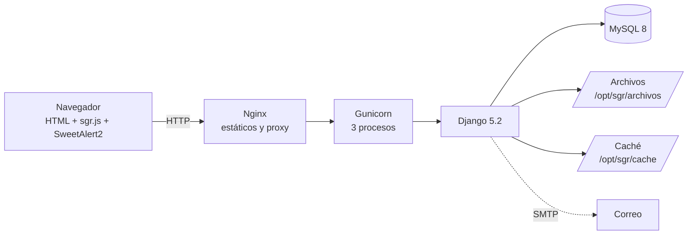

# Manual técnico · SGR La Serena

Para quien mantiene o extiende el sistema. La instalación está en [`../instalacion.md`](../instalacion.md); el modelo de datos en [`../bd/modelo_de_datos.md`](../bd/modelo_de_datos.md); la seguridad en [`../seguridad/owasp_top10.md`](../seguridad/owasp_top10.md).

---

## 1. Arquitectura



- **Monolito Django** con plantillas del servidor: no hay API pública ni framework de JavaScript. El JavaScript (`static/js/sgr.js`) solo mejora la experiencia (validación previa, confirmaciones, lista dependiente, medidores) y el sistema funciona igual si falla.
- **Sin dependencias en CDN**: Bootstrap Icons y SweetAlert2 están en `static/vendor/`, lo que permite una CSP `'self'`.
- **Configuración por variables de entorno** (`.env`), nunca en el código.

### Pila

| Capa | Tecnología | Versión |
|---|---|---|
| Lenguaje | Python | 3.11 – 3.13 |
| Framework | Django | 5.2 LTS |
| Base de datos | MySQL (producción) · SQLite (desarrollo y pruebas) | 8.0 · 3 |
| Servidor de aplicación | Gunicorn | 23+ |
| Proxy y estáticos | Nginx · WhiteNoise | — |
| Excel | openpyxl | 3.1 |
| Pruebas | unittest de Django · Playwright · Locust | — |

---

## 2. Estructura del código

```
sgr/            settings.py (todo por variables de entorno), urls.py, wsgi.py
core/           motor CRUD (crud.py), auditoría (models.py), seguridad (seguridad.py),
                exportación Excel (excel.py), etiquetas de plantilla (templatetags/sgr_tags.py)
cuentas/        Usuario, Rol, Permiso, acceso y recuperación, middleware de delegación activa,
                permisos (permisos.py), módulos del menú (modulos.py), datos iniciales (inicial.py)
catalogos/      Delegación, Ítem de medición, Cargo, Tipo y Sub atención (mantenedores)
atenciones/     Atención a vecinos por RUT (EV1)
gestion/        Matriz SGR: modelos, reglas.py, calculos.py, forms.py, views.py,
                importacion.py (base JJVV), inicial.py (períodos, metas y demostración)
templates/      layouts/, parciales/, una carpeta por app
static/         css/sgr.css, js/sgr.js, vendor/, img/
pruebas/        pruebas funcionales (196)            pruebas_ui/  navegador real (17)
pruebas_estres/ Locust y monitor de recursos       scripts/     matriz de pruebas, EXPLAIN, SQL
deploy/         instalar_ec2.sh, actualizar.sh, sgr.service, nginx-sgr.conf
docs/           bd/, seguridad/, pruebas/, manuales/
```

---

## 3. Cómo viaja una petición

1. `SecurityMiddleware` y `SeguridadMiddleware` (`core/seguridad.py`): cabeceras y límite por IP en acceso y recuperación.
2. `AuthenticationMiddleware`: identifica al usuario.
3. `ContextoDelegacionMiddleware` (`cuentas/middleware.py`): calcula `request.delegaciones_autorizadas` y `request.delegacion_activa`, validando en cada petición que la delegación guardada en la sesión siga autorizada.
4. La vista se protege con `@permiso_requerido('modulo', 'accion')` (`cuentas/permisos.py`). Si falta el permiso, `denegar()` responde 403 y lo registra en la auditoría.
5. Dentro de la vista, **acceso por objeto**: `actividades_visibles(request)` filtra por delegación activa y, si el usuario no ve al equipo, por funcionario; `obtener_actividad(request, pk)` devuelve `None` si la actividad está fuera de su alcance.
6. Las operaciones que cambian datos llaman a `registrar(request, evento, entidad, …)` (`core/models.py`).

### Permisos

Un **permiso** es un par `modulo.accion` (`ver`, `crear`, `editar`, `eliminar`, `exportar`). Los **roles** agrupan permisos y tienen **alcance** global (todas las delegaciones) o por delegación (solo las asignadas al usuario). Los módulos y su grupo en el menú están en `cuentas/modulos.py`; los roles iniciales en `cuentas/inicial.py` (`ROLES`).

---

## 4. La matriz SGR

### 4.1 Dónde vive cada regla

| Regla | Código | Cómo |
|---|---|---|
| 1 · Delegado solicitante sin puntaje | `reglas.evaluar_puntaje` | `puntua=False` con motivo |
| 2 · Nombre y teléfono | `reglas.evaluar_puntaje`, `reglas.normalizar_telefono`, `ActividadForm` | Teléfono inválido se rechaza; faltante deja sin puntaje |
| 3 · Máximo 7 por día | `reglas.validar_cupo_diario` en `views.actividad_nueva` | Dentro de `transaction.atomic()` con `select_for_update()` sobre el usuario, para que dos envíos simultáneos no pasen ambos |
| 4 · Cierre semanal | `reglas.validar_fecha_actividad`, `fecha_minima_de_ingreso` | Se valida en el formulario y de nuevo dentro de la transacción |
| 5 · Gestión previa sin puntaje | `reglas.evaluar_puntaje` | `naturaleza=GESTION` |
| 6 · Alertas | `calculos.alertas_de_registro` | Tope diario, texto repetido, ingreso tardío, muchas sin puntaje |
| 7 · Tope 120 % | `calculos.indicadores` | `min(bruto, periodo.tope_item)` |
| 8 · Felicitaciones | `ObservacionForm`, `views.observaciones` | Respaldo obligatorio; permiso `observaciones.crear` solo para delegados; nadie se registra a sí mismo |
| 9 · Ausencias | `AusenciaForm`, `calculos.dias_ausencia` | Permiso `ausencias.crear` solo para delegados; sin superposición; días recortados al período |
| 10 · Equipo | `calculos.resultado_equipo` | Promedio de quienes tienen metas |

`puntua` y `motivo_sin_puntaje` se calculan al registrar la actividad (`views.actividad_nueva` → `reglas.aplicar_reglas_de_puntaje`); los campos que los determinan (naturaleza, solicitante, teléfono) no se editan después. Así las sumas son un `COUNT` sobre índice.

### 4.2 Cálculo

`gestion/calculos.py` reproduce las fórmulas del Excel en un solo lugar (ver el encabezado del archivo). `indicadores(periodo, funcionarios)` hace **6 consultas agregadas** sin importar cuántas actividades haya:

1. Metas de los cargos involucrados
2. Avance por funcionario e ítem (`COUNT` agrupado)
3. Proporción TUBO por funcionario
4. Ausencias
5. Felicitaciones y reclamos
6. (en el tablero) contadores de la delegación

Los parámetros (topes, bono, descuento, umbrales) son columnas de `Periodo`, así un cambio de política no exige tocar código.

### 4.3 Fecha de trabajo

Todo lo que depende del día usa `reglas.hoy()`, que devuelve `settings.SGR_FECHA_HOY` si está definida. Las pruebas fijan el miércoles 04-11-2026 para que los bordes de semana sean reproducibles.

### 4.4 Evidencias

`gestion/forms.validar_archivo`:

1. Comprueba la extensión contra `SGR_EVIDENCIA_FORMATOS`.
2. Lee los primeros bytes y compara con la firma del formato (`%PDF`, `\x89PNG`, `\xFF\xD8\xFF`).
3. Rechaza archivos sobre `SGR_EVIDENCIA_MAX_MB`.

El archivo se guarda como `evidencia/<uuid>.<ext>` (o `observacion/…` para los respaldos de felicitaciones) bajo `SGR_ARCHIVOS_DIR`, que **no** se publica por Nginx. La descarga pasa por `views.evidencia_descargar`, que valida el alcance antes de entregar un `FileResponse`.

### 4.5 Importación de la base JJVV

`gestion/importacion.py` lee el Excel por nombre de columna (tolerante a espacios), normaliza el nombre, traduce el territorio a la delegación, asigna la subfamilia por palabras clave, omite registros repetidos por número de personalidad jurídica y anota en `observacion` todo dato dudoso (socios no numéricos, fechas en texto, inscripción anterior a la constitución, territorio inferido). No pisa organizaciones marcadas como verificadas.

---

## 5. Comandos de administración

| Comando | Para qué |
|---|---|
| `python manage.py sgr_inicializar [--demo] [--clave X]` | Permisos, roles, catálogos, cargos, ítems, período vigente y metas. Con `--demo`, cuentas y datos ficticios. Idempotente |
| `python manage.py sgr_importar_organizaciones archivo.xlsx [--simular]` | Importa la base de organizaciones |
| `python manage.py sgr_probar_correo correo@dominio` | Envía un correo de prueba con la configuración SMTP |
| `python scripts/generar_matriz_pruebas.py [--ui]` | Ejecuta las pruebas y regenera `docs/pruebas/matriz_pruebas_sgr_ev2.xlsx` |
| `SGR_DB_MOTOR=mysql python scripts/medir_consultas.py` | `EXPLAIN ANALYZE` de las consultas críticas con volumen sintético |

---

## 6. Configuración

Todas las variables están comentadas en [`.env.example`](../../.env.example). Las específicas de esta versión:

| Variable | Defecto | Uso |
|---|---|---|
| `SGR_ARCHIVOS_DIR` | `archivos/` | Evidencias y respaldos (en AWS, `/opt/sgr/archivos`) |
| `SGR_EVIDENCIA_MAX_MB` | 2 | Tamaño máximo por archivo |
| `SGR_CACHE_DIR` | `cache/` | Caché en archivos compartida por los procesos de Gunicorn (en desarrollo se usa memoria) |
| `SGR_IP_MAX_INTENTOS` / `SGR_IP_VENTANA_MIN` | 20 / 15 | Límite por IP en acceso y recuperación |
| `SGR_DETRAS_DE_PROXY` | `1` si `DEBUG=0` | Toma la IP de la última entrada de `X-Forwarded-For` |
| `SGR_FECHA_HOY` | vacía | Fija la fecha del sistema (pruebas y demostraciones) |

---

## 7. Cómo extender

### Agregar un ítem a la matriz

1. **Configuración → Ítems de medición → Nuevo** (o agréguelo a `ITEMS` en `cuentas/inicial.py` para que lo cargue `sgr_inicializar`). Elija medición **Conteo** o **TUBO**.
2. **Metas y ponderaciones**: asígnelo a los cargos que correspondan, cuidando que los ponderadores sumen 100 %.

No hay que tocar código: el cálculo recorre las metas del cargo.

### Agregar un mantenedor (CRUD)

1. Modelo en la app que corresponda y migración.
2. En `mantenedores.py` de la app, una subclase de `core.crud.Mantenedor` con `modulo`, `modelo`, `formulario`, `titulo`, `columnas`, `busqueda`, `exportar` y `detalle`.
3. Agregar `*MI_MANTENEDOR.urls('codigo')` en `urls.py`.
4. Registrar el módulo en `cuentas/modulos.py` y en `MANTENEDORES`, y los permisos en los roles de `cuentas/inicial.py`.

Obtiene listado, búsqueda, paginación, ver, crear, editar, activar/desactivar, eliminar con protección de relaciones, exportación a Excel y auditoría.

### Agregar una regla de puntaje

Agregue la condición en `reglas.evaluar_puntaje` (devuelve `(puntua, motivo)`) y una prueba en `pruebas/test_matriz.py`. Para recalcular las actividades ya registradas:

```python
from gestion.models import Actividad
from gestion.reglas import aplicar_reglas_de_puntaje
for a in Actividad.objects.all():
    aplicar_reglas_de_puntaje(a); a.save(update_fields=['puntua', 'motivo_sin_puntaje'])
```

---

## 8. Pruebas

```bash
python manage.py test pruebas          # 196 pruebas funcionales (≈ 12 s en SQLite, ≈ 25 s en MySQL)
python manage.py test pruebas_ui       # 17 pruebas en Chromium con capturas en docs/pruebas/evidencias/
```

Cada prueba lleva un identificador en la primera línea de su docstring (`RG-07 · …`) que la matriz de pruebas cruza con los casos funcionales. El plan completo está en [`../pruebas/plan_de_pruebas_ev2.md`](../pruebas/plan_de_pruebas_ev2.md).

---

## 9. Operación

| Tarea | Comando |
|---|---|
| Estado del servicio | `systemctl status sgr nginx mysql` |
| Registro de errores | `journalctl -u sgr -n 100` |
| Respaldo de la base | `mysqldump --single-transaction sgr_laserena > respaldo_$(date +%F).sql` |
| Respaldo de evidencias | `tar czf evidencias_$(date +%F).tgz -C /opt/sgr archivos` |
| Publicar versión nueva | `sudo bash /opt/sgr/app/deploy/actualizar.sh` |
| Salud | `curl http://127.0.0.1:8000/salud/` |
